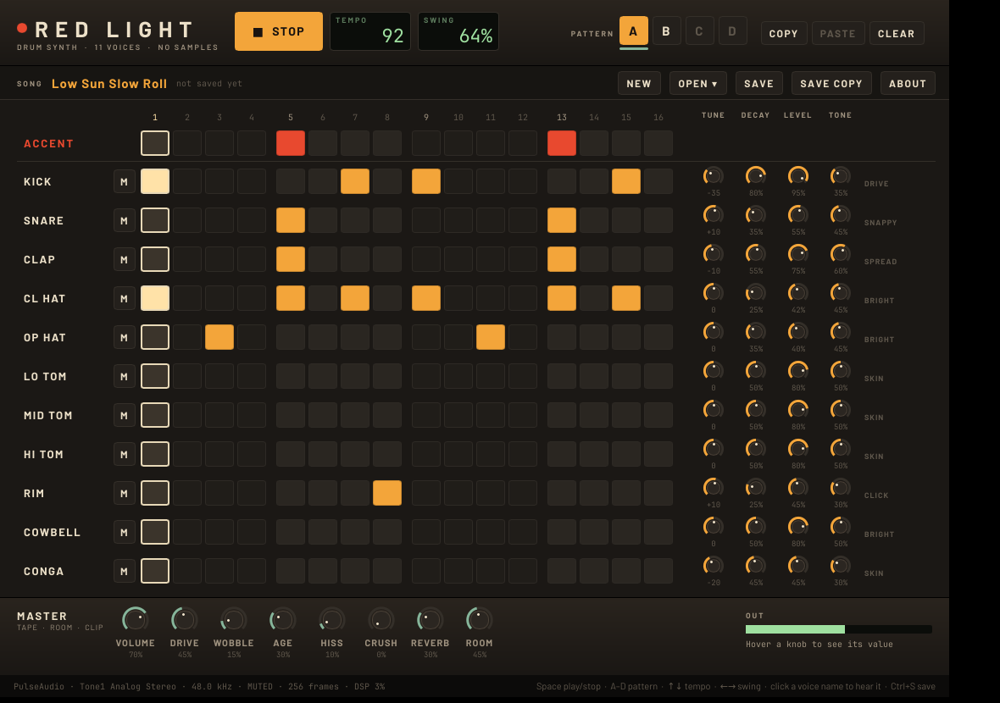

# Red Light

A free, open-source desktop drum machine for Linux and macOS, inspired by 80s analog drum machines: eleven voices, all synthesized from oscillators, noise and filters, with no samples. There's a 16-step sequencer with four pattern slots and swing, and a master chain with tape grit, reverb and a soft clipper. It's a sibling of [Plaza](https://github.com/nunyabiz765/plaza), the 80s-style polysynth, built the same way: Rust, a Slint UI, and cpal audio. The name is the red recording light over a studio booth door.

Red Light was called Backroom in its first release (0.1.0). Songs saved by Backroom are copied into the new song folder the first time Red Light starts, and Backroom's own folder is left as it was.

v0.1 has no AI or network features. [Sal the producer](#coming-next-sal-the-producer) is coming next.

## Download

From the [latest release](https://github.com/nunyabiz765/redlight/releases/latest). The app downloads each have a `.sha256` beside them. The release also has the four demo songs as MP3s, so you can hear it first.

- **Linux x86_64:** `redlight-0.1.1-x86_64-linux.tar.gz`. Built on Debian 12, so it should run on any distro from about 2022 on (glibc 2.35+). Unpack it and run `./redlight`, or run `./install.sh` to put it in `~/.local/bin` with an app-menu entry and icon (user folders only, no root). Sound goes through PulseAudio's protocol, which PipeWire serves on current desktops, with ALSA as the fallback.
- **macOS 11+ (Apple Silicon and Intel):** `redlight-0.1.1-macos-universal.dmg`. Drag Red Light into Applications. This build is **not signed or notarized by Apple**, so macOS blocks the first open: on macOS 14 and older, right-click (or Control-click) Red Light in Applications, choose **Open**, then click **Open**. On macOS 15 and newer, double-click it once and click Done, then go to System Settings → Privacy & Security, find "Red Light was blocked" and click **Open Anyway**. macOS remembers the choice after that. Songs live in `~/Library/Application Support/Red Light`.
- There's no Windows build yet.

Turn your volume down before the first play: the kick has a lot of low end.



## Features

- **Sequencer:** 16 steps, an accent row, and four pattern slots (A–D) with COPY/PASTE and CLEAR. Tempo runs 60–180 BPM and swing 50–75%. If you switch slots while playing, the switch waits for the bar line, and a green underline shows which slot is actually sounding.
- **Sample-accurate clock** in the audio thread, one tick per sample. Steps land on exact sample positions whatever the buffer size, and the clock doesn't drift: tested over ten minutes at 93.7 BPM.
- **11 voices**, each with TUNE, DECAY, LEVEL, a voice-specific fourth knob, and a mute:

  | Voice | How it's made | 4th knob |
  |---|---|---|
  | Kick | Tuned sine with a fast pitch drop, a noise click, and soft saturation. The decay runs from 0.16 s to about 2.5 s | DRIVE |
  | Snare | Two detuned sine "heads" plus high-passed noise | SNAPPY (noise level) |
  | Clap | Band-passed noise through three quick bursts and a longer tail | SPREAD (gap between the bursts) |
  | Closed hat | Six inharmonic square waves, band-passed and high-passed, plus some noise. It chokes the open hat | BRIGHT |
  | Open hat | The same metal bank with a long decay | BRIGHT |
  | Low/mid/high tom | Sine with a gentle pitch bend and a puff of noise | SKIN |
  | Rimshot | Two high sines, very short, overdriven and high-passed, with a noise click | CLICK |
  | Cowbell | Two detuned square waves (540/800 Hz) through a band-pass, with a fast drop into a longer ring | BRIGHT |
  | Conga | A short, high, slightly bent sine with a skin click | SKIN |

- **Master:** VOLUME, then the tape stage lifted from Plaza: DRIVE (saturation), WOBBLE (wow and flutter), AGE (top-end loss), HISS and CRUSH (bit and rate reduction). After that comes Plaza's FDN reverb (REVERB level, ROOM size), with per-voice sends so the kick stays dry. Last is a soft clipper whose ceiling is −0.45 dBFS (0.95).
- **Songs** are readable JSON in `~/.local/share/redlight/` (macOS: `~/Library/Application Support/Red Light/`). Each track is a step string like `"x... x... x... x..."`. On first start, Red Light writes four original demo songs there, and it never overwrites them afterwards, so edits you make to a demo are kept. If that folder doesn't exist yet but Backroom's (`~/.local/share/backroom/`, macOS `~/Library/Application Support/Backroom/`) does, its songs are copied across first; songs in the old `backroom-song` format open normally.
- **Offline render** to 24-bit WAV, with no audio device needed.

## Demos

| File | Song | Tempo / swing | Notes |
|---|---|---|---|
| `demo-dusty-boom-bap` | Dusty Boom-Bap | 89 BPM, 60% | Swung kick, rim ghost, crushed and aged tape |
| `demo-night-signal-electro` | Night Signal Electro | 116 BPM, 52% | Syncopated kick, clap, busy hats, cowbell; B has a tom run |
| `demo-low-sun-slow-roll` | Low Sun Slow Roll | 92 BPM, 64% | West-Coast-feel slow groove: deep long kick, layered snare and clap, open hats, more room |
| `demo-warehouse-four` | Warehouse Four | 124 BPM, straight | Four on the floor, off-beat open hats, conga and rim; B has a snare build |

All four are originals. Each has a main groove in A and a variation in B. The renderer plays them as A A A B.

## Controls

| | |
|---|---|
| Space | Play / stop |
| Esc | Stop |
| A–D or 1–4 | Pattern slot to edit (and play) |
| ↑ ↓ or + − | Tempo ±1 |
| ← → | Swing ±1% |
| Ctrl+S (Cmd+S on macOS) | Save |
| Click a step | Toggle it (the ACCENT row toggles accents) |
| Click a voice name | Hear that voice once |
| M | Mute the voice |
| Knobs | Drag up/down or scroll to turn. Double-click resets the knob to the value it had when the song was loaded or last saved |
| TEMPO / SWING readouts | Drag up/down or scroll |
| COPY → pick a slot → PASTE | Copy one pattern slot into another |
| NEW / OPEN ▾ / SAVE / SAVE COPY | Song files. SAVE overwrites the open file; SAVE COPY writes a new time-stamped one |
| ABOUT | Version, licences, link to the source |

## Command line

```
redlight                                   open the machine (starts on the boom-bap demo)
redlight --song warehouse --play           open a song (demo name, saved name or .json path) and start playing
redlight --render SONG OUT.wav [--bars N] [--rate 48000] [--tail 2]
redlight --kit OUT.wav                     every voice once, in kit order (for judging the sounds)
redlight --list                            demos and saved songs
redlight --muted                           run the engine but send silence (for screenshots)
```

`REDLIGHT_DATA=/some/dir` uses a different song folder (the old `BACKROOM_DATA` still works), and `REDLIGHT_BUFFER=512` changes the audio buffer size (the default is 256 frames).

## Build from source

You need a recent stable Rust. On Debian/Ubuntu also install `build-essential pkg-config libasound2-dev libfontconfig1-dev libfreetype6-dev libxkbcommon-dev`; on macOS the Xcode command-line tools are enough.

```
cargo build --release   # target/release/redlight
./install.sh            # Linux: builds, then ~/.local/bin/redlight + the "Red Light" app-menu entry and icon
cargo test              # 41 unit tests
tools/shots.sh          # retake docs/screenshots on a private Xvfb display (runs --muted, uses a temporary song folder)
```

Release builds: `tools/build-release.sh OUTDIR` makes the Linux tarball in a Debian 12 container (podman). `tools/package-macos.sh` makes the universal .dmg on a Mac. `.github/workflows/release.yml` does both on every `v*` tag.

## How it's put together

```
src/pattern.rs   the model: State, Grid, Song JSON, Command + State::apply, preview/ghost_diff
src/clock.rs     the sample-accurate swing clock
src/voices.rs    the 11 voices and the Kit (accent, level, choke, retrigger de-click)
src/engine.rs    clock + kit + mixer + master chain; render_song for offline renders
src/fx.rs        reverb and tape, lifted from Plaza
src/dsp.rs       filters, noise, soft clip, delay line, lifted from Plaza
src/storage.rs   the song folder: save (atomic rename), list, load, seed demos
src/demos.rs     the four demo songs
src/audio.rs     cpal output, adapted from Plaza
src/app.rs       Slint glue
ui/*.slint       the window
```

**Every edit goes through one function.** The UI never writes to pattern fields. A click becomes a `Command` (`SetStep`, `SetAccent`, `SetTempo`, `SetSwing`, `SetVoiceParam`, `SetMute`, `SetMaster`, `ClearPattern` or `CopyPattern`). `State::apply` validates it and changes nothing if it's out of range. Then the same command goes to the audio thread, which applies it to its own copy of the state. Commands are serde types tagged by `"cmd"`, for example:

```json
{"cmd":"set_step","slot":"A","voice":"open_hat","step":2,"on":true}
```

Steps are 0-based in the API (0–15) and 1-based on screen. `State::apply_all` applies a batch all-or-nothing. `State::preview` returns the resulting state plus the list of steps the batch would add or remove (`Ghost`), without touching the real state.

## What's tested

All 41 unit tests pass (`cargo test`):

- **Clock and swing timing:** straight 16ths land on exact samples at 120 BPM. Swing delays only the off-beat 16th. A bar is the same length at every swing setting. There's no drift over ten minutes at 93.7 BPM. A tempo change takes effect at the next step. Stopping and restarting begins again at step 1.
- **Pattern JSON:** the round trip is exact, and serializing again gives identical text. Bad files are rejected: wrong format, out-of-range tempo, unknown voice, short step string, broken JSON. Missing voices and master settings fall back to defaults. All four demos survive the round trip.
- **Edit commands:** every command does what it says. Invalid edits (step 16, tempo 59 or 181, NaN, swing out of range, knob out of range) are rejected and leave the state unchanged. Batches are all-or-nothing. Commands deserialize from tool-call-style JSON, and unknown commands are rejected. Preview reports the right ghost notes and doesn't modify the original.
- **Voice rendering:** each of the 11 voices was rendered at every combination of tune (−1/0/1), decay (0/0.5/1) and tone (0/1), at full level with accent. In every render the voice sounds (peak over 0.1, energy in the first 50 ms), never produces NaN or infinity, and never exceeds 1.0. Every voice decays to true silence. Accent is louder, and level 0 is silent. The decay knob lengthens the kick (under 0.3 s at minimum, over 1.2 s at maximum), and its home pitch is 49 Hz. The closed hat chokes the open hat. Retriggering a ringing voice doesn't jump.
- **Engine:** with every voice on every step, all levels and decays maxed, every master knob at 1.0 and 180 BPM, the output stays at or under the 0.95 limit. A kick on step 5 sounds at the exact expected sample, plus the tape stage's 12 ms delay. Mute silences a voice. Slot switches wait for the bar line. Render length matches the bars.
- **Storage:** save, list, load and seed work, seeding never overwrites a song, and file names are made safe.
- **Plaza's own tests** for the lifted reverb, tape and DSP blocks still pass here.

Every release build also runs the tests, renders a demo offline and opens the window (muted) on Linux (Debian 12, Xvfb) and macOS (GitHub's macOS runner, Apple Silicon, plus an offline render of the Intel half under Rosetta).

**Checked by hand on 2026-11-08 (Linux):**

- The release build runs under Xvfb.
- The window draws correctly, Space starts playback, the playhead moves, clicking steps, accents and slots works, and the OPEN menu lists the songs. This is in `tools/shots.sh`.
- The audio device opened through PulseAudio/PipeWire at 48 kHz with a 256-frame buffer and about 2% DSP load. That run was muted.
- The release tarball, downloaded back from GitHub, matches its checksum, unpacks, and renders a demo with `redlight --render`.
- The demos rendered at about 95x real time.

## What's not tested

- **The sounds were tuned from measurements, not by ear.** Every automated check is numeric: peaks, decay times, pitch, spectrum, waveform views. The automated real-time runs were muted. Listening reports are very welcome.
- Long sessions on a real desktop (Wayland, KDE, GNOME); the automated runs use Xvfb.
- **macOS** has only been built and smoke-tested on GitHub's runner so far: no real-Mac listening, HiDPI or long-session testing yet. The Intel build has only rendered offline under Rosetta.
- MIDI: none in v0.1. There's no MIDI clock or note input yet.
- Windows: no build.

## Sound: honest notes

Judged from renders, spectra and levels, not from listening:

- **Likely good:** the kick (clean sine body, controllable boom, and DRIVE adds grit), the toms and conga (simple, which is right for this style), and the cowbell (the two detuned squares through a band-pass is the classic recipe, and the spectrum shows 540 and 800 Hz on top).
- **Probably fine, may need tuning:** the clap (the burst timing is right, but it's the loudest voice once A-weighted, so it may need to come down), the snare (the noise is bright, with a spectral centroid around 7.8 kHz, so it may sound fizzy rather than crisp), and the rimshot.
- **Most likely to need work:** the hats. The six-square metal bank is there, but band-pass placement makes or breaks hats, and these haven't been heard. They may sound thin or "digital": the squares are band-limited with PolyBLEP, but the noise adds a hiss-like edge. The open hat's tail could also be too long at high DECAY.
- Accent is a fixed −4.4 dB on unaccented hits. Old analog machines also changed the timbre on accent; here only the kick does that (more drive).

## Coming next: Sal the producer

Not in v0.1. The plan for v0.2 is Sal, an AI producer character who edits patterns only when asked.

- **Persona:** Sal is an original character: an unhurried, dry-humoured engineer who has sat behind a lot of desks. Sal doesn't imitate, name-check or channel any real producer, and doesn't claim to.
- **Only on request:** nothing runs in the background. Sal is called only when you press ASK SAL or type a request, for example "make B a fill", "push the hats back" or "more swing".
- **Never in the audio path:** the request runs on a worker thread. The audio thread only ever receives the same validated `Command`s as a mouse click, so a slow or failed API call can't glitch playback.
- **Tool calls are the existing commands:** the tool schema is `Command`, which is already a serde type. Sal sees the song as the same JSON it's saved in, with readable step strings, and returns a batch of commands.
- **Ghost notes, accept/reject:** the batch goes through `State::preview`. Added steps draw as outlined ghost cells, removed ones as dimmed cells, and tempo, swing and knob changes are listed. You can audition the preview, then ACCEPT (it's applied with `apply_all`, all-or-nothing) or REJECT (nothing changes). One undo step covers the whole batch.
- **API key in the OS keychain:** the key is stored through the Secret Service (KWallet or GNOME Keyring), never in the song files or a config file. Without a key, Red Light works exactly as it does in v0.1.
- **Privacy:** only the current song JSON and your request are sent, no audio and no file paths.

What v0.1 already provides for this: the serde `Command` enum, `apply`, `apply_all`, `preview`, `ghost_diff`, and tests for each. What's missing: the ghost rendering in the UI, the API client, keychain storage and undo.

## Credits and licences

- Red Light is MIT OR Apache-2.0, at your option (`LICENSE-MIT`, `LICENSE-APACHE`). Copyright 2026 NICKSOSA.TECH LLC (Center Point Labs).
- UI toolkit: [Slint](https://slint.dev), used under the Slint Royalty-free Desktop, Mobile, and Web Applications License 2.0 (`LICENSES/LicenseRef-Slint-Royalty-free-2.0.md`), which is not covered by Red Light's MIT/Apache terms. The ABOUT dialog shows the AboutSlint widget, as that licence requires; keep it in modified builds. See `NOTICE`.
- The reverb, tape stage, DSP blocks, WAV writer, audio-thread layout and knob interaction are from [Plaza](https://github.com/nunyabiz765/plaza) (same author, MIT OR Apache-2.0), marked in each file.
- Fonts: Barlow and JetBrains Mono, SIL OFL 1.1 (`LICENSES/`).
- Release downloads include `THIRD-PARTY-LICENSES.txt` for the Rust crates linked in.
- Red Light is inspired by 80s analog drum machines in general. All sounds are synthesized (no samples), the demo songs are originals, and it isn't affiliated with or endorsed by any instrument maker.
